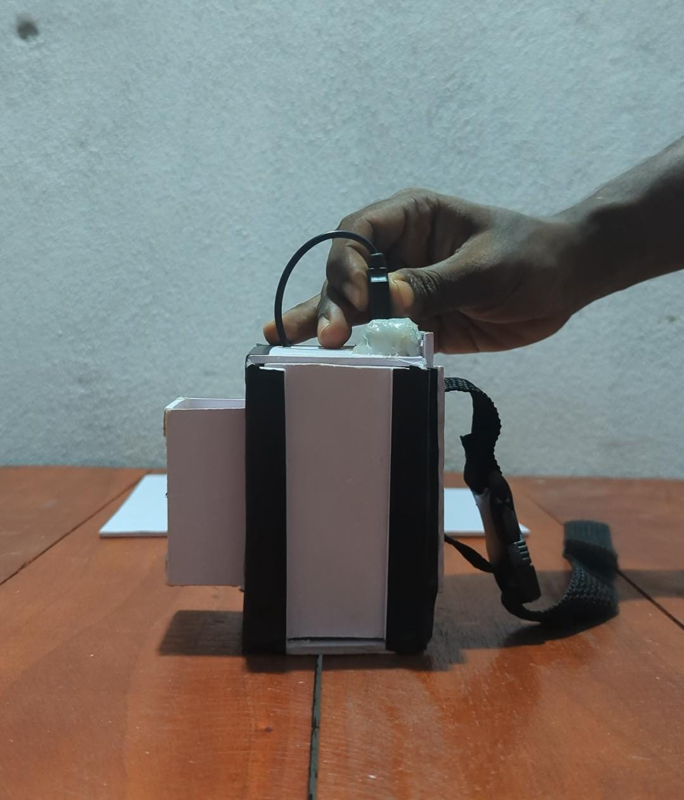

# 🎨 ChromaSpeak

### Arduino-Based Smart Colour Detection and Voice Assistant

  

**Detect Colours • Identify Colours • Speak Colours**

An Arduino-based smart system that detects different colours using a TCS3200 colour sensor and announces the detected colour through a DFPlayer Mini audio module.

---

## 📌 About the Project

ChromaSpeak is an Arduino-based colour detection and voice assistant system.

The system uses a TCS3200 colour sensor to detect the colour of an object. After detecting the colour, the Arduino processes the RGB values and compares them with predefined colour values.

Then, the system identifies the closest matching colour and plays the corresponding voice message through a speaker using the DFPlayer Mini.

This project aims to make colour identification easier and more accessible through audio feedback.

## ✨ Features

- 🎨 Detects different colours using a TCS3200 sensor.
- 🔴 Identifies Red, Green, Blue, Yellow, Orange, Purple, White and Black.
- 🔊 Announces detected colours through audio.
- 🔘 Push-button controlled colour detection.
- ⚡ Battery-powered operation.
- 📊 RGB colour value processing.
- 🎵 Audio playback using DFPlayer Mini.

## 🛠️ Hardware Components

| Component | Purpose |
|---|---|
| Arduino Uno / Nano | Main controller |
| TCS3200 Colour Sensor | Colour detection |
| DFPlayer Mini | Audio playback |
| Micro SD Card | Stores audio files |
| Speaker | Voice output |
| Push Button | Starts colour detection |
| YN-T6455-C Boost Converter | Power supply |
| Battery | Portable power source |
| Jumper Wires | Circuit connections |

## 🔌 Pin Configuration

### TCS3200 Colour Sensor

| TCS3200 Pin | Arduino Pin |
|---|---|
| S0 | 4 |
| S1 | 5 |
| S2 | 6 |
| S3 | 7 |
| OUT | 8 |

### DFPlayer Mini

| DFPlayer Pin | Arduino Pin |
|---|---|
| TX | 10 (Arduino RX) |
| RX | 11 (Arduino TX) |
| VCC | Suitable power supply |
| GND | GND |
| SPK1 / SPK2 | Speaker |

### Push Button

| Component | Arduino Pin |
|---|---|
| Push Button | 2 |
| Other terminal | GND |

## ⚙️ How It Works

1. The system starts and waits for the components to initialize.
2. The user places an object in front of the TCS3200 colour sensor.
3. The user presses the push button.
4. The sensor reads Red, Green and Blue colour channels.
5. Arduino collects five samples and calculates average RGB values.
6. The system compares the RGB values with predefined colours.
7. The closest matching colour is selected.
8. DFPlayer Mini plays the corresponding audio file.
9. The speaker announces the detected colour.

## 🎵 Audio Files

Store the audio files inside the `MP3` folder on the micro SD card.

| File Name | Colour |
|---|---|
| 0001.mp3 | Red |
| 0002.mp3 | Green |
| 0003.mp3 | Blue |
| 0004.mp3 | Yellow |
| 0005.mp3 | Orange |
| 0006.mp3 | Purple |
| 0007.mp3 | White |
| 0008.mp3 | Black |

## 💻 Software Requirements

- Arduino IDE
- SoftwareSerial Library
- DFRobotDFPlayerMini Library

### Installation

1. Download or clone this repository.
2. Open `ChromaSpeak.ino` using Arduino IDE.
3. Install the required libraries.
4. Connect the hardware components according to the pin configuration.
5. Insert the prepared micro SD card into DFPlayer Mini.
6. Upload the Arduino code.
7. Press the button to detect colours.

## 🎬 Project Demonstration

Watch our project demonstration:

[▶️ ChromaSpeak – Video Demonstration](video.mp4)

## 👥 Our Team

We developed this project as a group.

### ChromaSpeak Development Team

*Department of ICT*  
*Faculty of Technological Studies*  
*University of Vavuniya*

## 🚀 Future Improvements

- Add more colour categories.
- Improve colour detection accuracy.
- Support multiple languages for voice output.
- Add Bluetooth connectivity.
- Improve battery efficiency.
- Develop a more user-friendly design.

## 🎯 Project Goal

Our goal is to develop a low-cost, portable and user-friendly colour identification system that can identify colours and provide audio feedback.

---

**Made with ❤️ by Team ChromaSpeak**

*University of Vavuniya*

